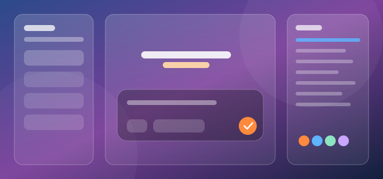

# dsh-ui-skin · DSH 界面皮肤

给 **DeepSeek Harness 桌面版（Web 客户端）** 换外观的轻量插件：静态壁纸、分区透明度、
玻璃质感的弹层、底部输入栏与交互配色、全局文字颜色、首页标题文字。
全部在 **设置 → 外观** 里调，改完立即生效。



## 功能

| 你想要的 | 插件里怎么做 |
| --- | --- |
| 换壁纸 | 纯色 / 渐变（色环自选颜色和角度）/ 本地静态图片，可再加暗化遮罩与模糊 |
| 磨砂玻璃质感 | 「玻璃质感」卡：左右侧边栏整体磨砂，对话框/菜单/卡片也磨砂；中间对话区保持平面半透明。可调磨砂强度、噪点、边缘高光，默认开启 |
| 改透明度 | 对话界面、工作区文件栏、左侧边栏、底部输入栏、弹层菜单各自一个不透明度 |
| 改 bottom 和交互色 | 底部输入栏底色单独调；发送键、链接、焦点框、选中描边共用一个「交互强调色」 |
| 文件栏和对话分开设置 | 两者是独立的两张卡，互不影响 |
| 轨迹 / 统计等子页面也要透 | 页面、表格、卡片统一走「一列一层玻璃」方案，不会因为多层叠加变成实心 |
| 文字看得清 | 默认自动提高可读性：对比度不够时自动加深对应面板；也可以自己指定文字颜色 |
| 首页那行字改成自己的 | 大标题、「预览版」小标签都能换文字、换颜色，鲸鱼图标也能换 |
| 轻、稳、不打架 | 单个浏览器 bundle，不用构建、不注入 `<script>`、不改 DSH 源码 |

## 安装

### 方式 A：本地目录（开发和自用推荐）

```powershell
# 1. 先装插件自己的依赖（只用到 DSH 的 schemastery）
pnpm install

# 2. 装进 desktop profile（注意不是 web）
dsh plugin --profile desktop add "link:<本目录绝对路径>"

# 3. 重启 DSH 桌面版（Host 半的 Config 有新增字段时必须重启）
```

也可以在 **插件** 页右上角「添加插件 / Add plugin」里直接选这个目录。

> 用 `link:` 安装时 pnpm 不会自动装「被链接包」的依赖，所以第 1 步别省。
> 从 npm / git 安装（`dsh plugin --profile desktop add github:<owner>/<repo>` 或包名）会自动装依赖。
> 升级本插件后如果新增/删除了设置字段，也要重启 DSH，旧进程里的 Host 配置 schema 不会热更新。

### 方式 B：从 GitHub / npm

```powershell
# 直接从这个仓库装
dsh plugin --profile desktop add github:worsle37/dsh-ui-skin

# 或发布到 npm 后按包名装
dsh plugin --profile desktop add dsh-ui-skin
```

安装完重启 DSH，在 **设置 → 外观** 里开始调。

## 使用

**设置 → 外观** 一共这些卡：

- **启用皮肤**：关掉立即恢复 DSH 原生外观，设置本身保留（这个页面本身不会变丑）。
- **壁纸**：渐变 / 纯色 / 图片 / 关闭；渐变可用色环选起点、终点和角度；图片会先在浏览器里
  压到 1920px 以内的 JPEG 再保存，不上传、不外传。图片模式下方有 16:9 预览：
  **直接拖动预览就能调整壁纸露出位置**，旁边有缩放（100–250%）和「居中」。
- **对话界面 / 工作区文件栏 / 左侧边栏**：各自的玻璃底色和不透明度。
- **底部输入栏**：输入卡片底色和不透明度。
- **弹层与菜单**：对话框、下拉菜单、悬浮卡片的不透明度。
- **交互强调色**：只影响发送键、链接、焦点框、选中描边这类交互元素；
  文件图标、时间线等「语义色」保持 DSH 原样，不会被一起染色。
- **文字颜色**：留空 = 跟随主题（自动保证可读）；也可以指定一个全局文字色。
- **自动提高可读性**：对比度不足时自动加深面板，最多到接近不透明；关掉就完全按滑块来。
- **首页标题**：大标题文字、小徽标文字、标题颜色、鲸鱼图标（PNG 保留透明）。留空 = DSH 默认。

所有改动**即时生效**，并自动保存到当前 profile 的 Cordis patch（`dsh-ui-skin` 段），
刷新页面、重启 DSH、换端口都不会丢。关掉皮肤不会删设置，也不会让「外观」页失去样式。

## 实现要点（也解释了为什么稳定）

- **颜色走官方 `ctx.theme.overrideTokens()`**，每个 token 同时给 light/dark 一对值；
  不覆盖 `--dsw-alias-state-business-primary` 这类语义色，避免把文件图标、时间线一起染色。
- **一列一层玻璃**：左/中/右三列各画唯一一层半透明底色；列内 `bg-base`、`bg-layer-1..3`
  一律设为透明。原因是 DSH 的页面/表格/单元格会逐层重绘同一个 token——按 token 给 alpha
  会叠三四层后变成 0.99 不透明（轨迹页实测）。卡片、代码块、气泡这些「非铺满」表面
  用一个更低的三档 alpha，保留层次又不挡壁纸。
- **右侧文件栏**是 0 宽轨道 + dockkit 面板，所以由 `[data-dockkit-host]` 画那一层玻璃。
- **弹层与菜单**通过全局 token 覆盖（portal 到 body，不在列作用域里）。
- **壁纸画在 `html::before`**（fixed + 负 z-index），图片/渐变 URL 放 html 行内 CSS 变量，
  避免每次拖滑块都重写几百 KB 的 `<style>` 文本。
- **自动可读**：用壁纸平均色 + 面板颜色 + 文字色算对比度，不足时抬高该区域不透明度；
  图片壁纸会异步采样 16×16 缩略图的平均色。
- **明暗主题**：颜色按亮度自动给出深/浅两套可读变体，切主题不会「深底深字」。
- **首页文字**是唯一 DOM 补丁：只在空白会话首页按结构找「大标题 + 徽标」两个 span，
  卸载/关闭即恢复；找不到结构就什么都不做。
- **输入框**用内部草稿 + `compositionstart/end`，中文输入法组合期间不写回设置，
  退格/光标不会跳；这是 0.2.0 修的 bug。
- **Windows 圆角**：DSH 只给内容区左上角 16px 圆角，皮肤铺满壁纸后统一拍平，不留半圆缺口。

## 已知限制

- **只支持静态壁纸**（图片 / 纯色 / 渐变），不做动画或视频。
- **下拉菜单/账号菜单**的不透明度由 DSH 的 menu 材质在元素内部定义，不能在 token 层覆盖，
  所以它们保持 DSH 原生材质（本来就有背景模糊）。设置对话框等 portal 弹层是覆盖到的。
- 右侧文件栏依赖 DSH 的 dockkit 容器（`data-dockkit-host`）；未来 DSH 换掉它时，
  文件栏那一层玻璃会失效，其它部分不受影响。
- 文件类型图标（例如 `.md` 的蓝色）是 DSH 自带的语义色，不属于「交互强调色」。
- 极端颜色（纯白/纯黑）在另一套主题里会被自动压暗/提亮，所以设置页色块显示的是你选的原色。
- 壁纸图片存进 profile 的 patch 文件（base64，通常 100–300 KB），别放超大原图。

## 目录

```
dsh-ui-skin/
├─ package.json        # dsh.bundle.patch + dsh.client 声明
├─ cordis.patch.yml    # 把 Host 入口挂进 profile
├─ index.js            # Host 半：Config（= 设置命名空间）+ 关闭自动表单
├─ client.js           # 浏览器半：玻璃皮肤 / 设置页 / 首页补丁（全部逻辑）
├─ locale/{zh,en}.json # 插件页显示的标题与说明
├─ icon.svg            # 插件图标
├─ docs/               # 插件详情页图片（preview.svg）+ 开发记录（DEVLOG.md）
│                        # 改代码前先读 docs/DEVLOG.md：架构、机制、坑、下一步
├─ scripts/dev-instance.ps1  # 起隔离测试实例（不碰 desktop）
└─ LICENSE
```

## 开发

> 先读 [docs/DEVLOG.md](docs/DEVLOG.md)：当前版本、架构、关键机制、已知限制与下一步。

```powershell
# 语法检查（不需要构建）
node --check index.js
node --check client.js

# 起一个隔离的临时 profile + Web 实例做视觉验证（不碰 desktop）
powershell -NoProfile -ExecutionPolicy Bypass -File scripts\dev-instance.ps1 -Start
# 用完停掉（profile 目录 .dsh/profiles/skintest 可手动删）
powershell -NoProfile -ExecutionPolicy Bypass -File scripts\dev-instance.ps1 -Stop
```

改 `client.js` 后：client bundle 的 revision 由文件 mtime 决定，刷新页面即可加载新代码；
改 `index.js`（Host 配置 schema）后必须重启 DSH 才生效。

## 更新记录

- **0.3.2**：磨砂颜色保真——降低 `saturate` 色偏、侧栏/右栏不再大幅自动调透明，颜色按你设的
  「底色 + 不透明度」来；右栏颜色就是「工作区文件栏」那张卡。
- **0.3.1**：磨砂范围修正——只给**左右侧边栏整体**、对话框、菜单、卡片加磨砂（`backdrop-filter`），
  中间对话区保持原来的平面半透明玻璃；开磨砂时把侧栏/弹层底色调薄一点，壁纸才透得出来、磨砂才看得见。
- **0.2.1**：图片壁纸支持**拖动调整露出位置** + 缩放（100–250%）+ 一键居中；定位按原图像素尺寸计算，
  宽屏/窄窗口下也能准确对准想保留的部分。
- **0.2.0**：修 6 个实测问题——轨迹/统计等子页面不透、右侧卡片/底部输入栏/设置弹层不跟壁纸、
  禁用皮肤后「外观」页裸奔、Windows 左上角圆弧、强调色误染语义色、首页输入法/退格光标 bug；
  新增弹层不透明度、文字颜色、自动提高可读性；整体改为「一列一层玻璃」。
- **0.1.0**：首个版本，壁纸/透明度/底部与强调色/首页标题。

## License

MIT
